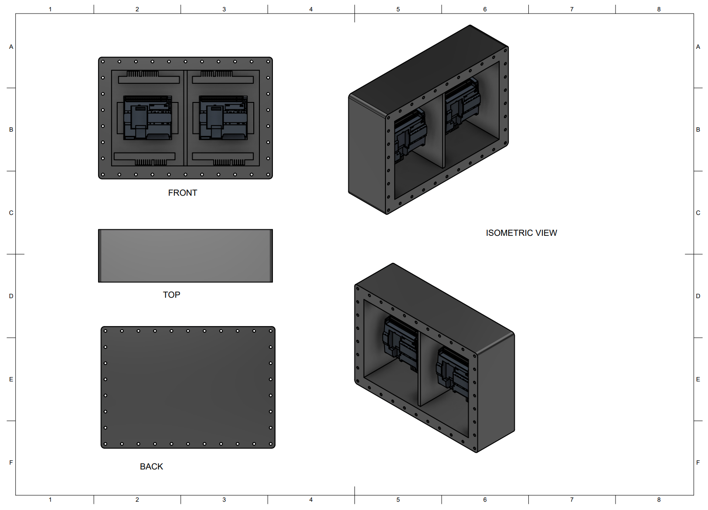

Part of the [Industrial Control System Digital Twin](../) project, for one of my Year-2 engineering project modules on the control, instrumentation, and automation systems for a conceptual autonomous underwater habitat.

I first made a sample model of a PLC enclosure on Fusion 360, sized to house the Siemens S7-1200 SIS and BPCS controllers, the PROFINET switches, and the distributed I/O terminals used in the [PLC and SIS Simulation](../PLC%20and%20SIS%20Simulation).

