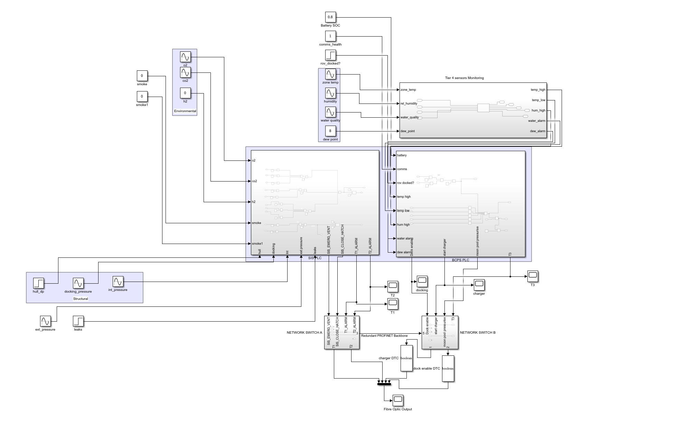

Part of the [Industrial Control System Digital Twin](../) project, for one of my Year-2 engineering project modules on the control, instrumentation, and automation systems for a conceptual autonomous underwater habitat.

For the control and automation portion of the project, I developed a **software-in-the-loop Simulink model of a dual-PLC architecture**, separating the habitat's safety functions from its normal process-control functions.

The system is modelled around two Siemens S7-1200 CPU 1214C controllers assigned separate roles:

- **Safety Instrumented System (SIS)** — critical alarms, voting logic, emergency interlocks, and protective actions
- **Basic Process Control System (BPCS)** — docking, pressurisation, charger sequencing, and normal process-control functions

The SIS and BPCS were implemented as separate subsystems, following IEC 61508 functional-segregation principles.

### Sensor Architecture

The complete instrumentation system contains **45 sensors represented by 74 individual measurement channels**.

The sensor network was divided into four tiers according to the consequence of failure.

#### Tier 1 — Life-Critical Sensors

- **Voting architecture:** `2oo3`
- **Hardware Fault Tolerance target:** HFT = 2
- **Target classification:** SIL 3
- **26 measurement channels**
- Includes:
  - Oxygen concentration
  - Carbon dioxide concentration
  - Hydrogen concentration
  - Hull differential pressure
  - Docking pressure
  - Internal habitat pressure
  - Smoke detection

#### Tier 2 — Structural and Flood Protection

- **Voting architecture:** `1oo2`
- **Hardware Fault Tolerance target:** HFT = 1
- **Target classification:** SIL 2
- **23 measurement channels**
- Includes:
  - External pressure
  - Leak detection
  - Internal habitat pressure

#### Tier 3 — Infrastructure and Availability

- **Voting architecture:** `2oo2`
- **Hardware Fault Tolerance target:** HFT = 1
- **Target classification:** SIL 1
- **17 measurement channels**
- Includes:
  - Battery state of charge
  - Communications health
  - Power and infrastructure status

#### Tier 4 — Environmental Monitoring

- **Voting architecture:** Single channel
- **8 measurement channels**
- Includes:
  - Zone temperature
  - Relative humidity
  - Water quality
  - Dew point

### Sensor Modelling

Analogue sensors were modelled as **first-order dynamic systems**:

$$
G(s)=\frac{K}{\tau s+1}
$$

where:

- `K` represents the sensor electrical transfer characteristic
- `τ` is derived from manufacturer `T90` response times
- 4–20 mA sensor gains are derived from their physical measurement range
- Analogue channels include simulated ADC quantisation
- Discrete sensors such as smoke detectors and leak strips use threshold-based logic

### Safety Voting & Interlock Logic

The SIS subsystem implements the voting logic for each safety tier before generating alarms and protective commands.

Implemented outputs include:

- `T1_ALARM`
- `T2_ALARM`
- `SIS_EMERG_VENT`
- `SIS_CLOSE_HATCH`
- Tier 3 infrastructure status

Faults were deliberately injected into the model using Step inputs.

At `t = 7 s`:

- A hull differential-pressure fault is introduced
- A leak condition is introduced
- `T1_ALARM` changes from `0 → 1`
- `T2_ALARM` changes from `0 → 1`
- `SIS_EMERG_VENT` changes from `0 → 1`
- `SIS_CLOSE_HATCH` changes from `0 → 1`

### SIS / BPCS Functional Segregation

The architecture separates safety functions from normal process-control functions.

**SIS**
- Critical sensor inputs
- Voting logic
- Safety alarms
- Emergency ventilation
- Hatch isolation
- Protective interlocks

**BPCS**
- Docking sequence
- Moon-pool pressurisation
- Charger start sequence
- Normal operational permissives
- `DOCK_ENABLE`

During the simulated SIS fault at `t = 7 s`, the BPCS `DOCK_ENABLE` signal remains at logic `1`.

### Redundant Industrial Network

The communication architecture uses a **redundant PROFINET star topology**.

The network includes:

- Two network switches
- Redundant communication paths
- Distributed I/O nodes
- Separate SIS and BPCS PLC connections
- Instrumentation nodes distributed throughout the habitat
- Fibre-optic telemetry connection towards shore

The architecture uses **Switch A + Switch B** for network redundancy and separates individual instrumentation branches through the star topology.

### Continuous Telemetry

Four system signals were multiplexed into the simulated fibre-optic telemetry path:

- Tier 1 alarm status
- Tier 2 alarm status
- Charger status
- Docking-enable status

The telemetry output remained active throughout the `0–15 s` simulation, including during the injected Tier 1 and Tier 2 fault events.

### Standards & Engineering References

The control and instrumentation architecture was developed using industrial standards and hardware documentation, including:

- **IEC 61508-2** — functional safety, segregation, SIL and hardware fault tolerance
- **IEC 61508-6 Annex B** — `1oo2`, `2oo2`, and `2oo3` voting architectures
- **ISA-5.1** — instrumentation and 4–20 mA conventions
- **IEEE 1451.0** — smart-sensor interfaces, status information and time synchronisation
- **IEC 60751** — RTD and temperature instrumentation
- **Siemens S7-1200 System Manual** — PLC electrical and power requirements

### Key Features

- Dual **SIS + BPCS PLC architecture**
- Siemens S7-1200 based design
- **45 sensors / 74 measurement channels**
- Four consequence-based sensor tiers
- `2oo3`, `1oo2`, `2oo2`, and single-channel voting
- Dynamic first-order sensor modelling
- 4–20 mA instrumentation modelling
- Fault-injection testing
- Safety alarms and automatic interlocks
- SIS/BPCS functional segregation
- Redundant **PROFINET star network**
- Distributed I/O architecture
- Continuous fibre-optic telemetry
